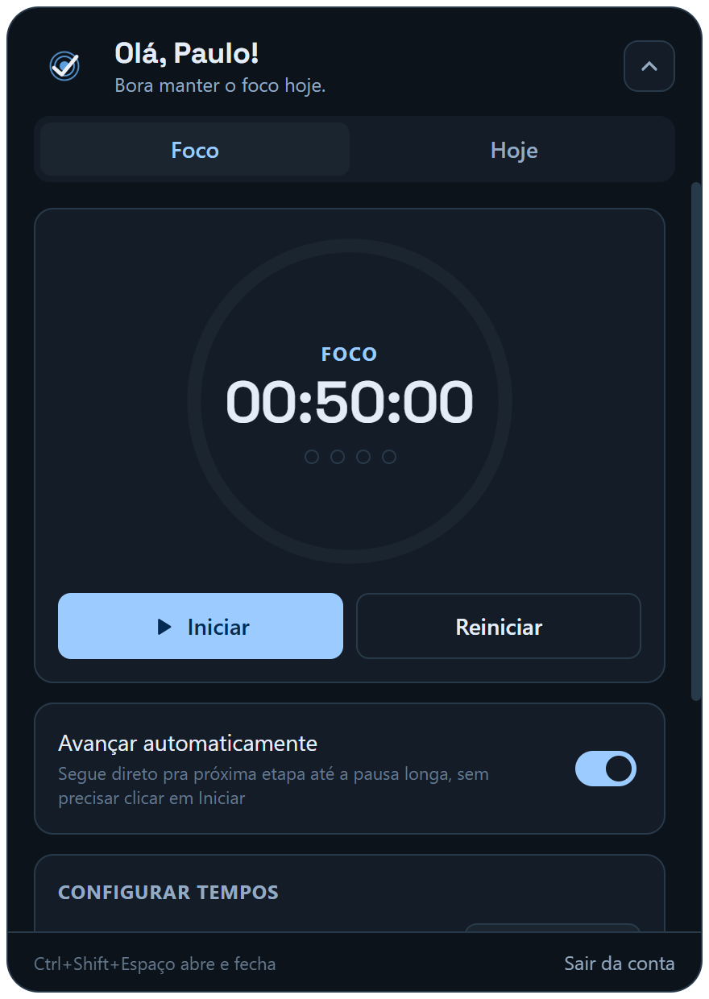

# FocoAprova Desktop

Pílula de estudo do [FocoAprova](https://github.com/paulosadev/FocoAprova) que fica sempre no topo da tela do Windows,
no estilo "Dynamic Island". Usa o mesmo Supabase do app: tudo que você estuda no PC aparece no celular e na web.

<p align="center">
  <br><br>
  
</p>

<p align="center">
  
  
  
  
  
</p>

## Download

Baixe o instalador para Windows 10/11 na
[página de releases](https://github.com/paulosadev/focoaprova-desktop/releases/latest), ou use o FocoAprova direto
no navegador em **[focoaprova.vercel.app](https://focoaprova.vercel.app)**.
O instalador ainda não tem assinatura digital: se o Windows mostrar "O Windows protegeu o computador", clique em
**Mais informações** e depois em **Executar assim mesmo**.

## Tecnologias

- **Electron 39**: janela transparente sempre no topo, bandeja, atalho global, notificações nativas e instalador
  NSIS (`electron-builder`).
- **React 19 + Vite 7**: interface da pílula e do painel, com recarregamento automático em desenvolvimento.
- **Supabase**: login (Google via PKCE e e-mail/senha) e o mesmo banco Postgres do app mobile, protegido por RLS.

## O que faz

- **Pílula no topo da tela**: centralizada e sempre por cima, inclusive de apps em tela cheia (sem bordas). Mostra o
  tempo do Pomodoro (MM:SS, ou H:MM:SS acima de 1h) e uma luz de status (foco, pausa ou parado).
  A área transparente em volta deixa o clique passar para as janelas de trás.
- **Painel**: abre clicando na pílula ou com `Ctrl+Shift+Espaço`; `Esc` ou clicar fora recolhe.
  - **Foco**: igual ao Timer do app. Pomodoro com foco, pausa curta e pausa longa, *Avançar automaticamente* (segue
    sozinho até a pausa longa) e tempos em HH:MM. Cada bloco de foco concluído é gravado em `sessoes_estudo`, com
    notificação do Windows e som.
  - **Hoje**: igual à tela Início do app. Frase do dia, dias para a prova, matérias do cronograma de hoje com
    checklist (e o último assunto estudado) e as anotações de erro para revisar hoje.
- **Login** com Google ou e-mail e senha, a mesma conta do app. A sessão fica salva.
- **Bandeja do Windows**: abrir painel, abrir o FocoAprova na web, esconder a pílula, iniciar com o Windows e sair.
- **Offline**: se a internet cair, a sessão de estudo fica na fila e sobe quando a conexão voltar.

## Como rodar

Requisitos: Windows 10/11 e Node.js 20 ou mais novo.

1. Instale as dependências:
   ```bash
   npm install
   ```
2. Copie `.env.example` para `.env` e preencha com os **mesmos valores** do `.env` do app
   (`EXPO_PUBLIC_SUPABASE_URL` → `VITE_SUPABASE_URL`, `EXPO_PUBLIC_SUPABASE_ANON_KEY` → `VITE_SUPABASE_ANON_KEY`).
3. **Login com Google**: no painel do Supabase, em *Authentication → URL Configuration → Redirect URLs*, adicione:
   ```
   http://127.0.0.1:47811/callback
   ```
4. Rode em modo de desenvolvimento (com recarregamento automático):
   ```bash
   npm run dev
   ```

> As notificações do Windows só aparecem no app instalado: o Windows exige o atalho do menu Iniciar, que o
> instalador cria. Em `npm run dev` o som toca normalmente, mas o toast não aparece.

## Gerar o instalador

```bash
npm run dist
```

O instalador fica em `release/FocoAprova Setup <versão>.exe`. Ele instala só para o usuário atual (sem pedir
administrador) e cria o atalho **FocoAprova** no menu Iniciar. O app instalado carrega o build do `dist/`, não o servidor do Vite.

A sessão do modo dev e a do app instalado são separadas, então é preciso entrar na conta uma vez em cada um.

## Decisões técnicas

- **Janela de tamanho fixo com clique atravessando.** A janela sempre tem o tamanho do painel; recolhida, ela usa
  `setIgnoreMouseEvents(true, { forward: true })` e só a pílula recebe o mouse. Trocar entre pílula e painel não
  redimensiona nada, o que evita flicker e o bug de janela que "cresce" em telas com escala diferente de 100%.
- **Por cima até de tela cheia.** O nível `screen-saver` do `setAlwaysOnTop` é reaplicado sempre que a janela
  aparece, porque o Windows às vezes perde o *topmost* depois de esconder e mostrar.
- **Timer que não atrasa.** O Pomodoro guarda o horário de término (`fimEm`) e calcula o restante a partir do
  relógio, em vez de contar ticks. Mesmo que o Windows segure o `setInterval`, o tempo continua certo, e o timer
  sobrevive a um reinício do app.
- **Login Google em app desktop.** O processo principal sobe um servidor HTTP local em `127.0.0.1:47811` só para
  receber o `?code=` do OAuth, e a interface troca esse código pela sessão (fluxo PKCE). O servidor fecha sozinho
  depois do retorno ou de 5 minutos.
- **Fila offline.** Se a gravação da sessão de estudo falhar, ela vai para uma fila local e é reenviada quando o app
  abre de novo com a conta conectada.
- **Segurança do Electron.** `contextIsolation` ligado, `nodeIntegration` desligado e só uma API mínima exposta pelo
  `preload.js`.

## Estrutura

```
electron/main.js        janela sempre no topo, cliques passando pela área transparente, atalho, bandeja,
                        notificações e login Google (servidor local)
electron/preload.js     ponte segura entre a interface e o Electron
src/supabase.js         cliente Supabase (PKCE) e funções de login
src/lib/usePomodoro.js  timer baseado no horário de término (não atrasa) + gravação das sessões
src/lib/useHoje.js      dados da tela Início, lidos das tabelas do app
src/components/         Pilula, Painel, Login, AbaFoco, AbaHoje
```

O banco é o mesmo do app (`profiles`, `sessoes_estudo`, `disciplinas`, `checklist`, `anotacoes_erro`); o desktop
não cria tabelas. A anon key é pública por design, e quem protege os dados é o RLS do Supabase.

## Próximas ideias

- Tutor IA (explicar e gerar questões/flashcards a partir do texto copiado) via Edge Function.
- Modo foco que avisa quando abrir um site ou app de distração.
- Timer em andamento sincronizado com o celular (tabela de sessão ativa + Realtime).

## Autor

Feito por **Paulo Levy Soares e Sá** ([@paulosadev](https://github.com/paulosadev)), como parte do ecossistema
[FocoAprova](https://github.com/paulosadev/FocoAprova).
